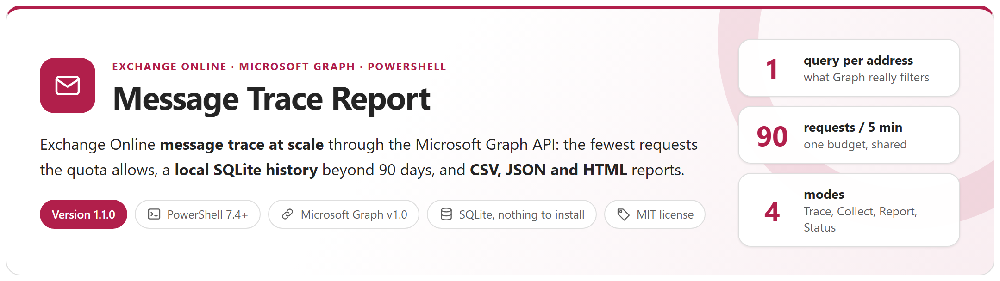
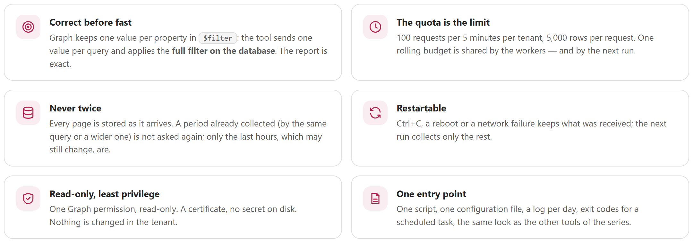
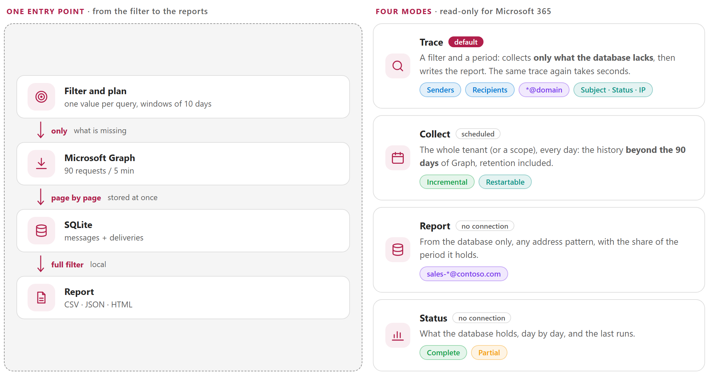
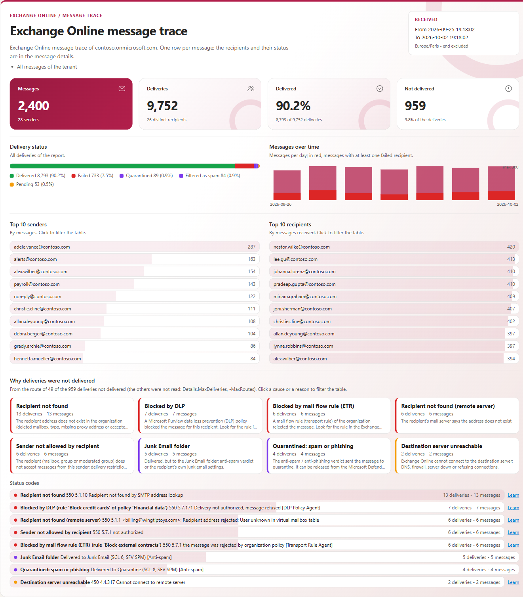
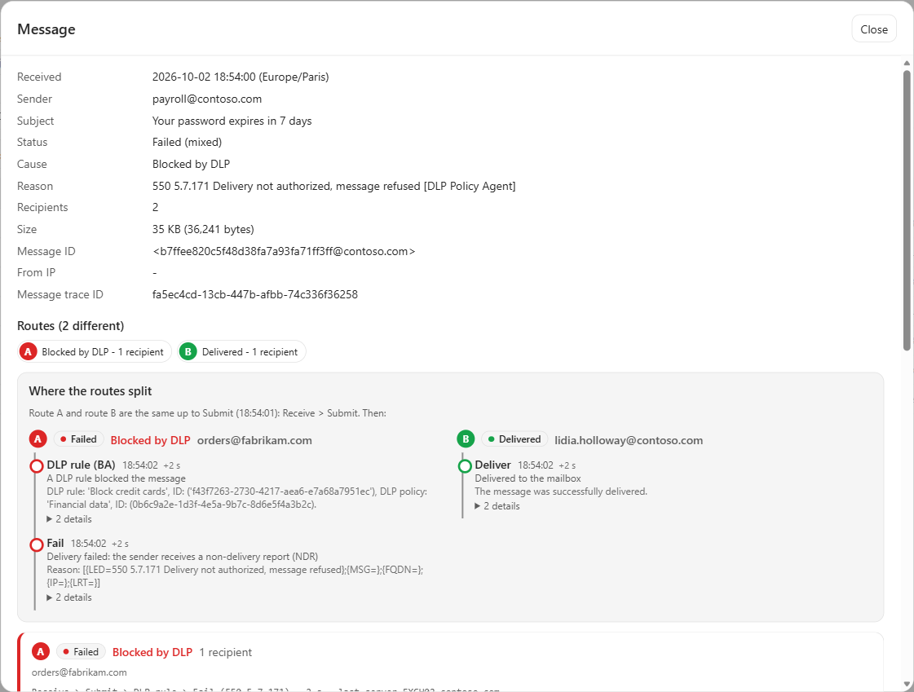
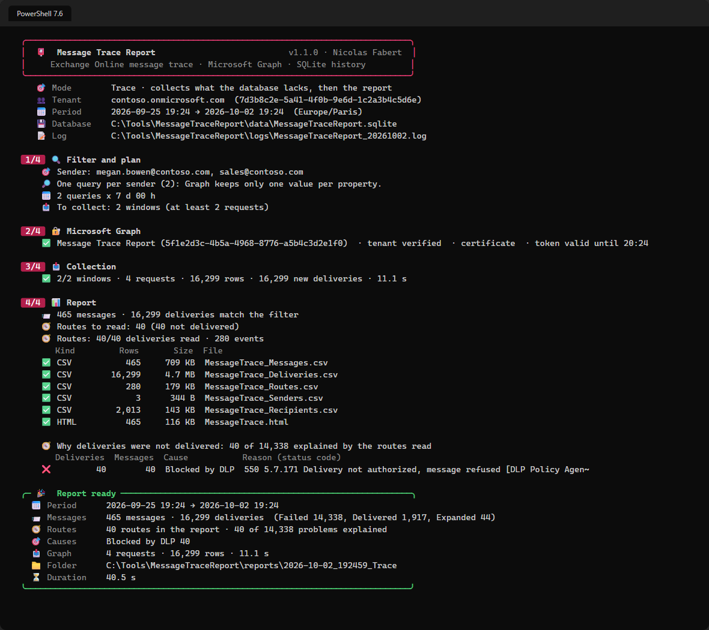
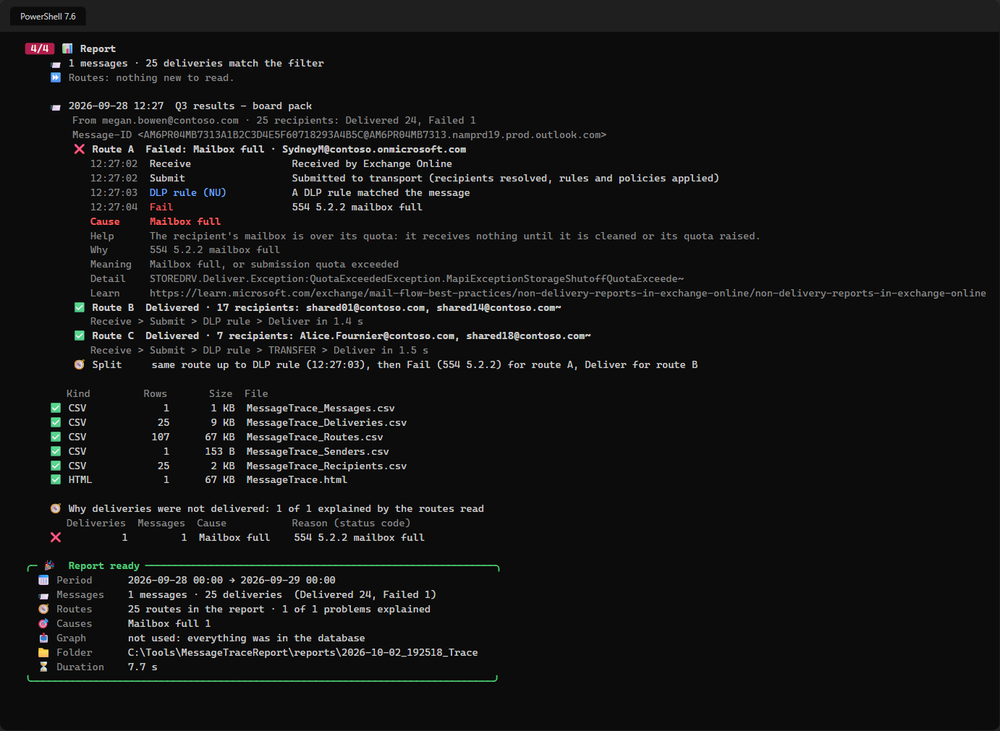

<p align="center">
  <picture>
    <source media="(prefers-color-scheme: dark)" srcset="package/docs/images/readme-banner-dark.png">
    
  </picture>
</p>

<p align="center">
  <a href="#why"><b>Why</b></a> &nbsp;&middot;&nbsp;
  <a href="#how-it-works"><b>How it works</b></a> &nbsp;&middot;&nbsp;
  <a href="#reports"><b>Reports</b></a> &nbsp;&middot;&nbsp;
  <a href="#get-started"><b>Get started</b></a> &nbsp;&middot;&nbsp;
  <a href="package/docs/MessageTraceReport-UserGuide.md"><b>User guide</b></a> &nbsp;&middot;&nbsp;
  <a href="package/docs/MessageTraceReport-Guide.md"><b>Developer guide</b></a>
</p>

> [!IMPORTANT]
> Files downloaded from the Internet may be blocked by Windows and fail to run. Before using this tool, unblock every file in the folder where you extracted it:
>
> ```powershell
> Get-ChildItem "C:\Tools\MessageTraceReport-1.1.1" -Recurse -File -Force | Unblock-File
> ```
>
> Replace the example path with the folder where you extracted the release ZIP.

## Why

Message Trace Report answers two everyday questions about Exchange Online mail: **did this message arrive, and who received it?** and **why was it not delivered?** It reads the message trace of Microsoft 365 through the Microsoft Graph API, which has strict limits (about 100 requests per 5 minutes for the whole tenant, 10-day windows, 90 days of history). The tool works within these limits for you, keeps everything it receives in a **local SQLite database** (a single file on your disk, nothing to install) and never asks Microsoft twice for what it already holds.

<picture>
  <source media="(prefers-color-scheme: dark)" srcset="package/docs/images/readme-principles-dark.png">
  
</picture>

## How it works

<picture>
  <source media="(prefers-color-scheme: dark)" srcset="package/docs/images/readme-how-it-works-dark.png">
  
</picture>

- **You give a filter** (senders, recipients, a domain such as `*@fabrikam.com`, a subject, a status, a message ID or an IP address). The tool works out what Microsoft must be asked and what it can answer from its own database, so the report is exact.
- **It stays inside the Microsoft limits**: it spaces its requests, waits when Microsoft asks it to and retries after a network error.
- **It is safe to interrupt**: press Ctrl+C or lose the network, and what was received is kept; the next run collects only the rest.
- **`-Mode Collect`** run every day keeps the whole tenant beyond the 90 days that Microsoft keeps; `-Mode Report` answers from the database alone, with any address pattern.
- **Why a message was not delivered**: with `-IncludeDetails`, each recipient gets a plain-words cause such as *Blocked by DLP*, *Blocked by mail flow rule (ETR)*, *Recipient not found*, *Mailbox full*, *Quarantined* or *Rejected by remote server*, with the rule, the status code and its Microsoft Learn page, and the point where the route of a failed recipient left the route of the delivered ones.
- **Read-only**: one permission (`ExchangeMessageTrace.Read.All`), certificate sign-in, nothing to install.

## Reports

<table>
  <tr>
    <td width="50%" valign="top"><a href="package/docs/images/report-overview-light.png"></a><br><sub><b>HTML report</b> &middot; tiles, delivery status, messages over time, top senders and recipients, why deliveries were not delivered</sub></td>
    <td width="50%" valign="top"><a href="package/docs/images/report-message.png"></a><br><sub><b>A message</b> &middot; recipients grouped by route, where the routes split, the cause and the rule</sub></td>
  </tr>
  <tr>
    <td width="50%" valign="top"><a href="package/docs/images/console-trace.png"></a><br><sub><b>Console</b> &middot; plan, Microsoft Graph, collection with a live progress line, files</sub></td>
    <td width="50%" valign="top"><a href="package/docs/images/console-route.png"></a><br><sub><b>One message</b> &middot; one recipient failed, the others delivered: why, and where the routes split</sub></td>
  </tr>
</table>

Each run writes `Messages.csv` (one row per message), `Deliveries.csv` (one row per message and recipient), `Routes.csv` (one row per step of the routes read), `Senders.csv` and `Recipients.csv` (per day), optionally JSON files, and a self-contained HTML report that stays fast with 200,000 messages.

## Requirements

| Item | Requirement |
|---|---|
| Windows PowerShell or PowerShell 7 | **PowerShell 7.4 or later** (`pwsh`). Windows PowerShell 5.1 is not enough. |
| Modules | None for certificate or secret sign-in. Interactive sign-in uses `Microsoft.Graph.Authentication`. |
| Permission | An app registration with the Microsoft Graph permission `ExchangeMessageTrace.Read.All` and admin consent. |
| Tenant | A *service principal* of the Microsoft message trace service: a one-time entry that lets Microsoft Graph answer message trace requests for your tenant. The [user guide](package/docs/MessageTraceReport-UserGuide.md#2-one-time-setup) gives the command. |
| SQLite | Bundled in `lib\sqlite`, nothing to install. |

## Get started

1. **Download** `MessageTraceReport-1.1.1.zip` from the [latest release](https://github.com/Nico77600/MessageTraceReport/releases/latest) (use this file, not the *Source code* archives).
2. **Extract** it, for example to `C:\Tools\MessageTraceReport-1.1.1`. The ZIP holds one folder, `MessageTraceReport-1.1.1`.
3. **Open PowerShell 7.** In File Explorer, open the extracted folder, click the address bar, type `pwsh` and press Enter. Check it:

   ```powershell
   $PSVersionTable.PSVersion
   Get-ChildItem . -Recurse -File -Force | Unblock-File
   ```

   You should see a version that starts with 7 (7.4 or later), then no output from the second command. If `pwsh` is not recognized, install PowerShell 7 first.
4. **Set up the application once and fill in the configuration**, as chapter 2 of the user guide explains, step by step (`docs\MessageTraceReport-UserGuide.html` in the ZIP; double-click it).
5. **Run your first trace:**

   ```powershell
   .\Invoke-MessageTraceReport.ps1 -Sender john@contoso.com -Range Last7Days -Open
   ```

   You should see the plan, a progress line, the list of files written under `reports\`, and the HTML report opening in your browser.

More commands, one per question:

```powershell
.\Invoke-MessageTraceReport.ps1 -Recipient *@fabrikam.com -Status Failed -Range Last7Days -Open
.\Invoke-MessageTraceReport.ps1 -SenderFile C:\Tools\MessageTraceReport-Data\vip.csv -Recipient *@gmail.com -Start 2026-09-01 -End 2026-10-01
.\Invoke-MessageTraceReport.ps1 -MessageId '<CAJ1234@mail.contoso.com>' -Range Last10Days -IncludeDetails   # why each recipient got it or not
.\Invoke-MessageTraceReport.ps1 -Mode Collect                                     # scheduled task, whole tenant
.\Invoke-MessageTraceReport.ps1 -Mode Report -Range Last30Days -Sender 'sales-*@contoso.com'
.\Invoke-MessageTraceReport.ps1 -Mode Status
```

Coming from `Invoke-MessageTraceGraph.ps1`? Its parameter names are kept as aliases (`-StartDate`, `-Senders`, `-RecipientsCsv` ...): see the [migration table](package/docs/MessageTraceReport-Guide.md#14-migrating-from-invoke-messagetracegraphps1).

## Documentation

| Guide | Content |
|---|---|
| **[User guide](package/docs/MessageTraceReport-UserGuide.md)** | What you need before the first trace, the one-time setup step by step, then one command per everyday question: a sender, a domain, a list of addresses, a message ID, why a recipient did not get it, the daily collection, a report from the database. How to read the results and what to do when something goes wrong. |
| **[Developer guide](package/docs/MessageTraceReport-Guide.md)** | Everything else: how the Graph API behaves and how the tool plans around it, performance figures, every configuration key, the routes in detail, the scheduled collection, the report columns, exit codes and logs, the migration from the original script, the internals and how to test a change. |

Both guides also exist as a single HTML file with a light and a dark theme, `docs\MessageTraceReport-UserGuide.html` and `docs\MessageTraceReport-Guide.html`, in the release ZIP.

## For developers

```powershell
git clone https://github.com/Nico77600/MessageTraceReport.git
cd MessageTraceReport
Invoke-Pester -Path .\tests          # Pester 5+, in-memory Graph API, no connection to Microsoft 365
.\tests\New-DemoReport.ps1 -Open     # a report of fictitious Contoso data, through the real engine
.\tools\New-MtrPackage.ps1 -Zip      # builds the release ZIP content
```

The run-time files are in `package\`. `tools\Build-Documentation.ps1` rebuilds the HTML guides; `tools\New-ReadmeImages.ps1` renders the graphics of this page.

## License

[MIT](LICENSE). The bundled SQLite components keep their own licenses: see [THIRD-PARTY-NOTICES.md](package/THIRD-PARTY-NOTICES.md).

## Disclaimer

This Script is a Personal project.
It's provided "AS-IS". It's not an official Microsoft product so no support can be expected from Microsoft.

As any scripts you must read carefully the documentation and test it first in a Test environment before any run in Production.
