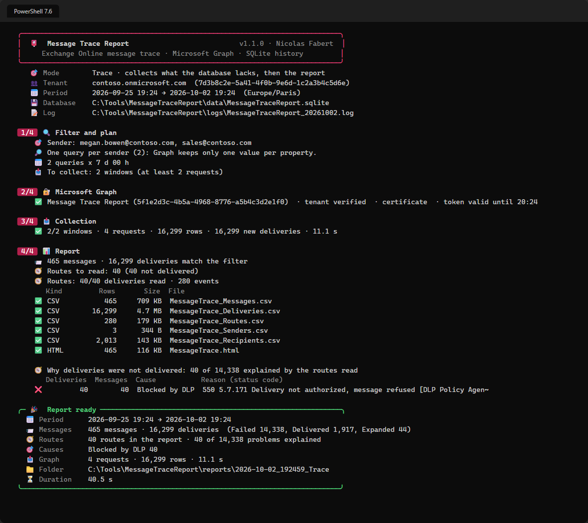
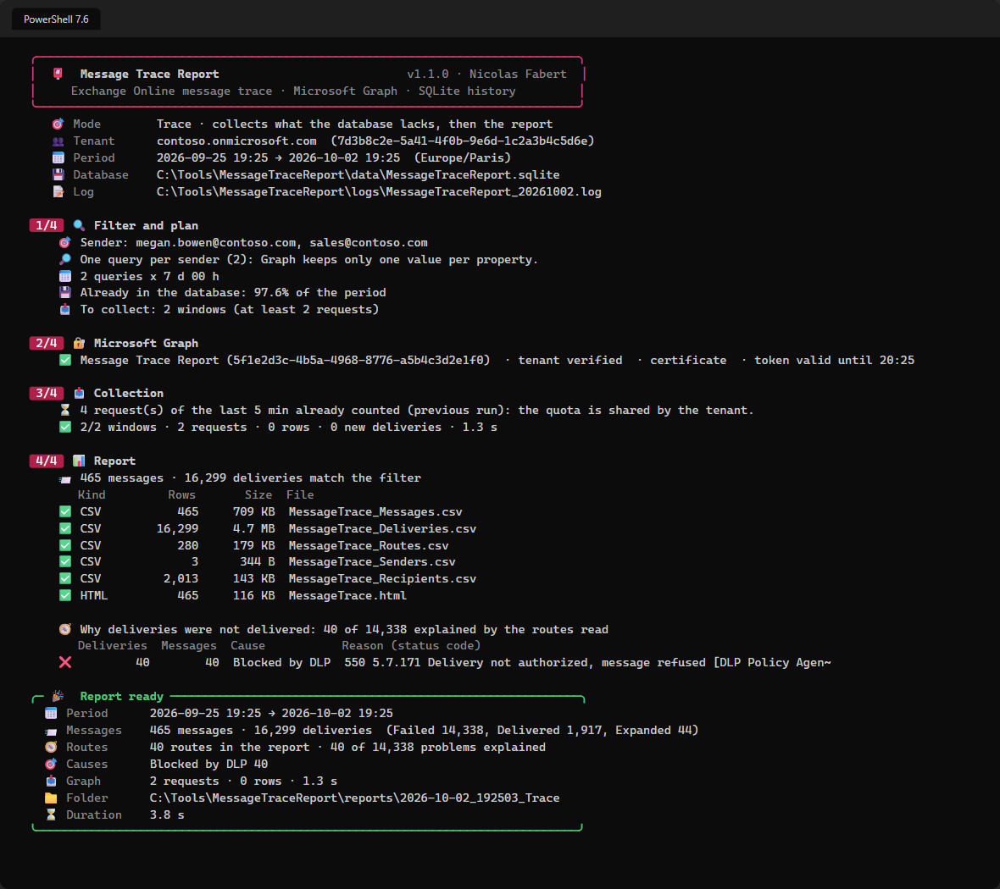
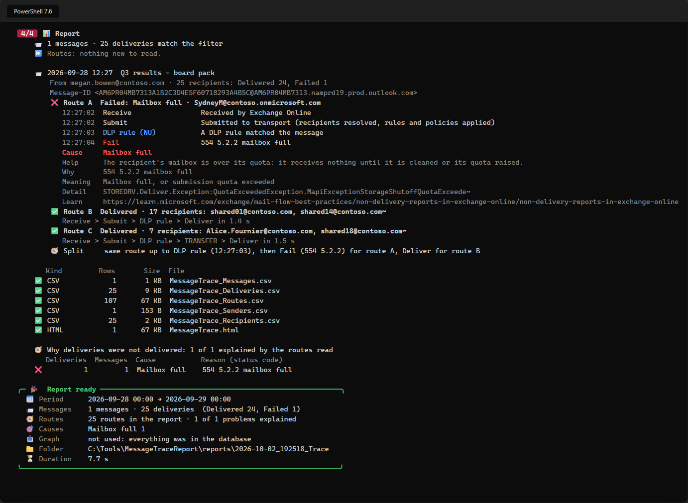

# Message Trace Report — User guide

> What you need before the first trace, then one command per everyday question: **did this message leave, and who received it?**, **why was it not delivered?**, **every message of this list of people to that domain last month**, **what does the database already hold?** How the tool works inside, every setting and the internals are in the [developer guide](MessageTraceReport-Guide.md).

> [!IMPORTANT]
> Files downloaded from the Internet may be blocked by Windows and fail to run. Before using the tool, unblock every file in the folder where you extracted it (step 3 of chapter 2 shows how):
>
> ```powershell
> Get-ChildItem "C:\Tools\MessageTraceReport-1.1.1" -Recurse -File -Force | Unblock-File
> ```
>
> Replace the example path with the folder where you extracted the release ZIP.

```cards
checklist | Prerequisites | PowerShell 7.4+, an application with a certificate, one Microsoft Graph permission.
terminal | Everyday use | One command per question: a sender, a domain, a message ID, a list of addresses.
search | Why it failed | `-IncludeDetails` reads the route of each recipient and names the cause.
file | Results | CSV, optional JSON and a self-contained HTML report under `reports\`.
```

# Part I · Start here

<!-- icon: checklist -->
## 1. Prerequisites

| Item | Requirement |
|---|---|
| Operating system | Windows 10 / 11 or Windows Server 2019 or later (x64 or ARM64) |
| PowerShell | **7.4 or later** (the program is called `pwsh`). Windows PowerShell 5.1, the blue window that opens with `powershell`, is **not enough**. |
| Console | Windows Terminal recommended (colours and emoji); the classic console works with simple symbols. |
| Modules | **None** to run the tool with a certificate or a client secret. Interactive sign-in needs `Microsoft.Graph.Authentication`. |
| Rights in Microsoft 365 | An account that can create an app registration and grant admin consent (for example Application Administrator and Global Administrator), only for the one-time setup. |
| Tenant | Global Microsoft 365 service only (not GCC High, DoD or 21Vianet). |
| Network | `https://login.microsoftonline.com` and `https://graph.microsoft.com` (the system proxy is used). |
| SQLite | Bundled in `lib\sqlite`: nothing to install. |

Words used in this guide:

| Word | Plain meaning |
|---|---|
| Tenant | Your organization in Microsoft 365. Its tenant ID is a long identifier (a GUID). |
| Microsoft Graph | The Microsoft web service that gives access to Microsoft 365 data, here the message trace. |
| App registration | The identity you create for this tool in Microsoft Entra ID, so that it can sign in without a person. |
| Admin consent | A click by an administrator that allows the app to use the permission. Without it the permission does nothing. |
| Certificate and thumbprint | The tool proves who it is with a certificate kept on the computer. The thumbprint is the short code that identifies that certificate. |
| Service principal | The entry that makes an application exist inside one tenant. The message trace service of Microsoft needs one in your tenant; step 8 of the setup creates it. |
| SQLite database | A single file, `data\MessageTraceReport.sqlite`, where the tool keeps everything it has already read. |

> [!IMPORTANT]
> The tool is **read-only** for Microsoft 365: it only asks for message traces and changes nothing in the tenant. The database, the reports and the logs stay on the local disk.

> [!WARNING]
> `data\`, `reports\` and `logs\` contain e-mail addresses and subjects. Restrict the NTFS permissions of the tool folder to the administrators who run it.

<!-- icon: download -->
## 2. One-time setup

Do the steps in order, in the same PowerShell 7 window, from step 2 on. Each step says what to do, what you should see, and what to do if not. The sample folder is `C:\Tools\MessageTraceReport-1.1.1`; use your own if you prefer.

> [!NOTE]
> Keep your own files (address lists, the certificate file) **outside** the tool folder, for example in `C:\Tools\MessageTraceReport-Data`. The tool checks its own folder at every start and refuses a folder that holds a file it does not know. Reports, the database and logs are written to their own sub-folders, which are not checked.

### Check the download

The release is a ZIP, `MessageTraceReport-1.1.1.zip`, on the [Releases page](https://github.com/Nico77600/MessageTraceReport/releases/latest). Use that file, not the *Source code* archives. Its PowerShell files carry the owner's timestamped digital signature, and a signed list (`PackageIntegrity.psd1`) records the fingerprint of every other file.

**Do:** compare the fingerprint of the ZIP with the `SHA256` line of the release notes, and read the signature of the entry script after extraction:

```powershell
(Get-FileHash "$HOME\Downloads\MessageTraceReport-1.1.1.zip" -Algorithm SHA256).Hash
Get-AuthenticodeSignature C:\Tools\MessageTraceReport-1.1.1\Invoke-MessageTraceReport.ps1 | Format-List Status, SignerCertificate
```

**You should see:** the same 64 characters as in the release notes, then `Status : Valid` and a signer named *Nicolas Fabert*.

**If not:** download the ZIP again from the Releases page and extract it again. At every start the tool refuses a modified, re-saved or unsigned file with a message that starts with `Package integrity:` and does nothing else. The cause is a damaged or altered download, or a file added to the tool folder; the cure is a fresh download.

### 1 · Get the files

**Do:** extract `MessageTraceReport-1.1.1.zip` to `C:\Tools`. The ZIP holds one folder, `MessageTraceReport-1.1.1`.

**You should see:** `C:\Tools\MessageTraceReport-1.1.1` with `Invoke-MessageTraceReport.ps1`, `README.md` and the folders `config`, `docs`, `lib`, `src` and `templates`.

**If not:** if the files are directly in `C:\Tools`, move them into a folder named `MessageTraceReport-1.1.1`.

### 2 · Open PowerShell 7 in that folder

**Do:** in File Explorer, open `C:\Tools\MessageTraceReport-1.1.1`, click the address bar, type `pwsh` and press Enter. Then run:

```powershell
$PSVersionTable.PSVersion
Get-Location
```

**You should see:** a version that starts with 7 (7.4 or later) and the path `C:\Tools\MessageTraceReport-1.1.1`.

**If not:** if `pwsh` is not recognized, PowerShell 7 is not installed (or the window was opened before the installation): install it from Microsoft, then open a new window. If the version starts with 5, you opened Windows PowerShell, which is not enough: use `pwsh`.

### 3 · Unblock the files

**Do:**

```powershell
Get-ChildItem . -Recurse -File -Force | Unblock-File
```

**You should see:** no output and no error.

**If not:** *access denied*: close programs that use the folder and run the window as the same user who extracted the ZIP.

### 4 · Create the certificate

**Do:** on the computer, and for the account that will run the tool, create a certificate and save its public part. Keep `$cert` for the next steps:

```powershell
$cert = New-SelfSignedCertificate -Subject 'CN=MessageTraceReport' -CertStoreLocation Cert:\CurrentUser\My -KeyExportPolicy NonExportable -KeySpec Signature -KeyAlgorithm RSA -KeyLength 2048 -HashAlgorithm SHA256 -NotAfter (Get-Date).AddYears(2)
New-Item -ItemType Directory -Force C:\Tools\MessageTraceReport-Data | Out-Null
Export-Certificate -Cert $cert -FilePath C:\Tools\MessageTraceReport-Data\MessageTraceReport.cer | Out-Null
$cert.Thumbprint
```

**You should see:** a code of 40 characters (the thumbprint). Copy it: you need it in step 9.

**If not:** if `$cert` is empty, run the first command again and read its error. For a scheduled task under a service account, use `Cert:\LocalMachine\My` instead and give that account read access to the private key.

### 5 · Register the application in Microsoft Entra

**Do:** sign in to the [Microsoft Entra admin center](https://entra.microsoft.com) as an administrator.

1. Go to **Entra ID > App registrations > New registration**.
2. Name: `MessageTraceReport`. Supported account types: **Accounts in this organizational directory only**. Leave the redirect URI empty. Click **Register**.
3. On the **Overview** page, copy **Application (client) ID** and **Directory (tenant) ID**.

**You should see:** the new application and its two identifiers.

**If not:** if *New registration* is greyed out, your account may not create applications; ask a Global Administrator or an Application Administrator.

### 6 · Upload the certificate

**Do:** in the application, open **Certificates & secrets > Certificates > Upload certificate**, choose `C:\Tools\MessageTraceReport-Data\MessageTraceReport.cer` and click **Add**.

**You should see:** the certificate in the list, with a thumbprint equal to the one of step 4.

**If not:** if the thumbprints differ, you uploaded another file; upload the `.cer` of step 4.

### 7 · Add the permission and grant admin consent

**Do:** open **API permissions > Add a permission > Microsoft Graph > Application permissions**, search `ExchangeMessageTrace.Read.All`, tick it and click **Add permissions**. Then click **Grant admin consent for your organization** and confirm.

**You should see:** `ExchangeMessageTrace.Read.All` of type *Application*, with a green check and *Granted for ...* in the **Status** column.

**If not:** if the permission is not in the list, search again with the exact name. If the consent button is greyed out, ask a Global Administrator to click it.

### 8 · Create the service principal of the message trace service

Microsoft runs the message trace service as its own application. It must have an entry (a service principal) in your tenant, once. It shows up as *Transport Data Platform*.

**Do:** with an Application Administrator account:

```powershell
Install-Module Microsoft.Graph.Applications -Scope CurrentUser
Connect-MgGraph -Scopes Application.ReadWrite.All
New-MgServicePrincipal -AppId 8bd644d1-64a1-4d4b-ae52-2e0cbf64e373
```

**You should see:** a sign-in window, then a table with the new service principal.

**If not:** if the message says it already exists, nothing is left to do. After the creation, Microsoft can take up to several hours to provision it: until then the first trace answers `401`, and chapter 8 explains it.

### 9 · Fill in the configuration

**Do:**

```powershell
notepad .\config\MessageTraceReport.config.psd1
```

Fill in `Tenant.TenantId` (the Directory ID of step 5), `Authentication.AppId` (the Application ID) and `Authentication.CertificateThumbprint` (step 4). Save the file.

**You should see:** the three values between quotes, for example `TenantId = '00000000-0000-0000-0000-000000000000'`.

**If not:** the tool lists every wrong value at the next start; fix them and run the next step again.

### 10 · Check without connecting

**Do:**

```powershell
.\Invoke-MessageTraceReport.ps1 -Mode Status
```

**You should see:** the banner with your tenant, then *No database yet*, and no red error. Nothing is sent to Microsoft in this step.

**If not:** a message starting with `Package integrity:` means a file of the folder differs from the signed release (see *Check the download*). A message about the configuration names the wrong value.

### 11 · First trace

**Do:** one sender over the last 7 days, and the report opened at the end:

```powershell
.\Invoke-MessageTraceReport.ps1 -Sender john@contoso.com -Range Last7Days -Open
```

**You should see:** the plan, a live progress line, the list of files written under `reports\`, and the HTML report opening in your browser.

**If not:** `401` or `403` means the service principal (step 8) or the admin consent (step 7) is not in place yet; the table of chapter 8 gives the exact message and the cure.

The settings you fill in once:

| Setting | Meaning |
|---|---|
| `Tenant.TenantId` | Tenant ID (GUID). The tool stops if the token belongs to another tenant. |
| `Authentication.Mode` | `Certificate` (recommended), `ClientSecret` or `Interactive`. |
| `Authentication.AppId` | Application (client) ID. Interactive: `''` = Microsoft Graph Command Line Tools. |
| `Authentication.CertificateThumbprint` | In `Cert:\CurrentUser\My` or `Cert:\LocalMachine\My`, with its private key. |
| `Report.TimeZone` | Dates and days of the reports (`Europe/Paris` by default). |
| `Report.DefaultRange` | Period used when none is given (`Last48Hours`). |

The tool creates, next to itself: `data\` (the SQLite database), `reports\` (one sub-folder per run) and `logs\` (one file per day). The developer guide covers client secrets, interactive sign-in and every other key.

# Part II · Everyday use

<!-- icon: play -->
## 3. Trace messages

Run the commands from that same folder, in PowerShell 7. `-Mode Trace` is the default: the tool collects from Microsoft Graph only what the database does not hold yet, then writes the report.

```powershell
# One sender, last 48 hours (Report.DefaultRange)
.\Invoke-MessageTraceReport.ps1 -Sender john@contoso.com

# Failed messages to a partner domain over 7 days, report opened at the end
.\Invoke-MessageTraceReport.ps1 -Recipient *@fabrikam.com -Status Failed -Range Last7Days -Open

# A list of VIPs (CSV, column detected) to Gmail in September
.\Invoke-MessageTraceReport.ps1 -SenderFile C:\Tools\MessageTraceReport-Data\vip.csv -Recipient *@gmail.com -Start 2026-09-01 -End 2026-10-01

# From OR to these addresses, with the route of the failed deliveries
.\Invoke-MessageTraceReport.ps1 -Sender alerts@contoso.com -Recipient helpdesk@contoso.com -Operator Or -IncludeDetails

# A subject, a message ID, a source IP
.\Invoke-MessageTraceReport.ps1 -Subject 'Invoice' -SubjectMatch StartsWith -Range Today
.\Invoke-MessageTraceReport.ps1 -MessageId '<CAJ1234@mail.contoso.com>' -Range Last30Days
.\Invoke-MessageTraceReport.ps1 -FromIP 203.0.113.25 -Range Yesterday
```



| I want… | Parameter |
|---|---|
| A period | `-Range Last24Hours \| Last48Hours \| Last7Days \| Last10Days \| Last30Days \| Last90Days \| Today \| Yesterday` |
| One day, or my own dates | `-Date 2026-09-28`, or `-Start` / `-End` (`yyyy-MM-dd`, `'yyyy-MM-dd HH:mm'` in the report time zone, or ISO 8601 with an offset; `-End` defaults to now) |
| Senders, recipients | `-Sender`, `-Recipient`: exact addresses or `*@domain`, several values separated by commas |
| A list of addresses | `-SenderFile` / `-RecipientFile`: `.csv` (column `Email`, `PrimarySmtpAddress`, `Address`, `Mail`… or `-FileColumn`) or `.txt`, one per line |
| Sender **or** recipient, instead of both | `-Operator Or` |
| A subject | `-Subject 'Invoice'` with `-SubjectMatch Contains` (default), `StartsWith`, `EndsWith` or `Equals` |
| One status | `-Status Delivered \| Failed \| Pending \| Expanded \| Quarantined \| FilteredAsSpam \| GettingStatus` |
| One message, or an IP address | `-MessageId '<…>'`, `-FromIP`, `-ToIP` |
| Other files, another folder | `-Format Csv,Html,Json`, `-OutputPath D:\Out` |
| The messages in a grid, the report opened | `-GridView`, `-Open` |
| To read the whole period again | `-Refresh` |

Before collecting, the tool prints its **plan**: your filter, what the database already holds and how much is left to ask Microsoft. A plan of more than 2,000 requests (`Collection.MaxQueries`) stops unless `-Force` is given. Running the same trace again only reads the last `Collection.SettlingHours` (4 h):



> [!TIP]
> A long investigation over many addresses can be interrupted with <kbd>Ctrl</kbd>+<kbd>C</kbd>: the pages already received are kept. Run the same command again to continue.

<!-- icon: search -->
## 4. Why a message was not delivered

The message trace gives the **status** of each recipient. `-IncludeDetails` also reads the **route** of the deliveries and names, for each recipient not delivered, the cause, the status code, the rule or the component that decided, and where its route left the route of the recipients who received the message.

```powershell
# One message: every recipient, grouped by identical route, in the console and the report
.\Invoke-MessageTraceReport.ps1 -MessageId '<CAJ1234@mail.contoso.com>' -Range Last10Days -IncludeDetails

# Failures of a sender over 7 days: up to 300 routes (default 100, Details.MaxDeliveries)
.\Invoke-MessageTraceReport.ps1 -Sender payroll@contoso.com -Range Last7Days -MaxRoutes 300 -Open
```



The causes are given in plain words — *Blocked by DLP*, *Blocked by mail flow rule (ETR)*, *Recipient not found*, *Mailbox full*, *Quarantined: spam or phishing*, *Rejected by remote server*… — with the status code and a link to its Microsoft Learn page. A selection of at most `Details.MaxDeliveries` deliveries (100) is read completely; a larger one reads the problems first, with one delivered recipient of the same message to compare. A route is read once and kept in the database.

The full list of causes and how each one is decided: [developer guide, chapter 9](MessageTraceReport-Guide.md#9-tracing-messages).

<!-- icon: calendar -->
## 5. Collect every day

`-Mode Collect` reads the last `Collect.Days` days of the whole tenant — or of the scope set in the `Collect` section — into the database: only what is missing and the last hours. Run every day, it keeps the history **beyond the 90 days of Graph**, and every trace of that period is then answered from the database.

```powershell
$action  = New-ScheduledTaskAction -Execute 'pwsh.exe' -Argument '-NoProfile -File "C:\Tools\MessageTraceReport-1.1.1\Invoke-MessageTraceReport.ps1" -Mode Collect' -WorkingDirectory 'C:\Tools\MessageTraceReport-1.1.1'
$trigger = New-ScheduledTaskTrigger -Daily -At 02:30
Register-ScheduledTask -TaskName 'Message Trace Report - Collect' -Action $action -Trigger $trigger -User 'CONTOSO\svc-mtr' -Password (Read-Host 'Password') -RunLevel Limited
```

The account of the task must hold the certificate (in its `Cert:\CurrentUser\My`, or `Cert:\LocalMachine\My` with read access to the private key). A first collection of 10 days is ten times longer than a daily one: run it once by hand with `Collect.Days = 10`.

<!-- icon: database -->
## 6. Report from the database, and the status

```powershell
# No connection, no quota - and any pattern is accepted in an address
.\Invoke-MessageTraceReport.ps1 -Mode Report -Range Last30Days -Sender 'sales-*@contoso.com'

# What the database holds, day by day, and the last runs
.\Invoke-MessageTraceReport.ps1 -Mode Status
```

`-Mode Report` never connects. When the database does not hold the whole period for this filter, the console and the report say how much it holds (*coverage*), and the exit code is `2`. `-Mode Status` shows the size of the database, the messages, the deliveries, the distinct queries, the collection day by day and the last runs.

<!-- icon: chart -->
## 7. Read the results

Each run writes a folder `reports\<yyyy-MM-dd_HHmmss>_<Mode>\`:

| File | One row per |
|---|---|
| `MessageTrace_Messages.csv` | message: received time, sender, recipients, recipient count, status, subject, size, Message ID, From IP, cause and reason of the worst recipient whose route was read |
| `MessageTrace_Deliveries.csv` | message **and** recipient: what Graph returns, then the route, the cause and the reason when the route was read |
| `MessageTrace_Routes.csv` | step of a route read: event, action, detail, status code, reason, component, remote server, facts |
| `MessageTrace_Senders.csv` · `_Recipients.csv` | sender · recipient, and per day: messages, delivered, failed, other, last message |
| `MessageTrace.html` | — the self-contained report |

CSV files are UTF-8 with BOM, `;` by default, and a cell starting with `=`, `+`, `-` or `@` is prefixed with `'` so that Excel never runs it as a formula. `-Format Json` also writes the data with the Graph property names.

The HTML report is one file that can be sent alone: tiles, delivery status, messages over time (failures in red), top 10 senders and recipients (click to filter), **why deliveries were not delivered** (one card per cause, then the status codes), and a table that stays fast with 200,000 messages — search, filters, sort, export of the view. Click a message to open its recipients and, when it was read, its route.

| Exit code | Meaning |
|---|---|
| `0` | Success. |
| `1` | Failure: configuration, filter, sign-in, permission, database. The summary gives the error. |
| `2` | Finished but incomplete: a window failed, the run was interrupted, or part of the period is not available. |

The daily log is `logs\MessageTraceReport_<yyyyMMdd>.log`: one line per event, the progress of a long collection every 60 seconds, and the Graph errors with their message.

# Part III · Troubleshoot

<!-- icon: lifebuoy -->
## 8. Common situations

| Symptom | Cause | What to do |
|---|---|---|
| `Package integrity: ...` at start | A file of the tool folder differs from the signed release, is unsigned, or an unknown file was added to the folder | Download the ZIP again from the [Releases page](https://github.com/Nico77600/MessageTraceReport/releases/latest), extract it again and unblock it. Keep your own files outside the tool folder. |
| `401 … Service principal-less authentication failed … 8bd644d1-…` | The *Transport Data Platform* service principal is missing, or not provisioned yet | Create it (chapter 2, step 8), then wait — up to several hours. |
| `The application has no application permission ExchangeMessageTrace.Read.All` | Permission not added, or admin consent not granted | Add it and grant admin consent; a new consent can take a few minutes to reach the token. |
| `403 Permission denied` | Same as above, or the delegated account has no right on message trace | Check the permission and the role of the account. |
| `AADSTS700027` · `AADSTS7000222` · `AADSTS700024` | Certificate not on the application, or another thumbprint · the client secret has expired · the clock of the computer is wrong | Upload the right `.cer` · move to a certificate · fix the time of the computer. |
| `Certificate … not found` | Imported for another account, or without its private key (`.cer` instead of `.pfx`) | Import the certificate with its private key for the account that runs the tool. |
| Many `Throttled by Microsoft Graph (429)` | Another tool uses the quota of the tenant (100 requests per 5 minutes) | Nothing: the tool waits and goes on. Lower `Throttling.MaxRequests` if it happens often. |
| `request refused (400) - … older than 90 days` | The window starts before the Graph history | Nothing to collect there; use the database (`-Mode Report`) for older periods. |
| `The plan needs N requests` | More than `Collection.MaxQueries` | Narrow the filter or the period, or add `-Force`. |
| `Another execution is already collecting` | The scheduled collection is running on the same database | Wait, or use `-Mode Report`. |
| Coverage below 100% in `-Mode Report` | The database does not hold the whole period for this filter | Run the same command without `-Mode Report`. |
| *Routes: nothing new to read* | The routes of the selection are already in the database, or the selection holds only delivered messages beyond `MaxDeliveries` | Nothing: routes are read once. Set `Details.OnlyProblems` to `$false` to read the delivered ones too. |
| Few routes read on a large selection | `Details.MaxDeliveries` (100) or `-MaxRoutes` | Raise `-MaxRoutes`; the problems of the newest messages are read first. |
| The HTML page stays on *Loading* | Old browser without `DecompressionStream` | Use a recent Edge, Chrome or Firefox, or the CSV files. |

For the behaviour of the Graph API, the performance figures, every configuration key, the migration from `Invoke-MessageTraceGraph.ps1` and the internals, continue with the [developer guide](MessageTraceReport-Guide.md).
